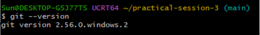
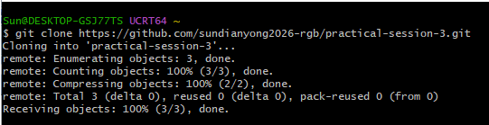
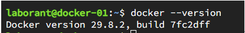
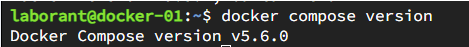
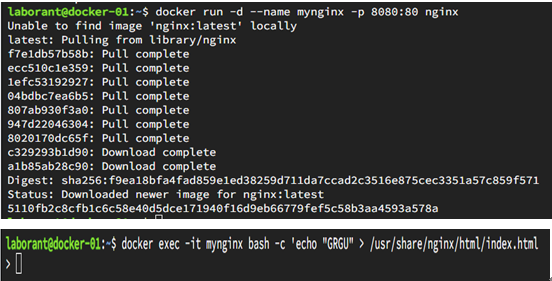

# Docker Lab Report

## Task 1: Install and verify Git
Git was installed on the local Windows machine.

## Task 2: Clone repository using Git
Cloned the GitHub repository successfully.

## Task 5: Attach screenshots for Task1 and Task2
Screenshots of Git version and repository clone are shown above.

## Task 3: Install and verify Docker
Docker environment was used via iximiuz online playground (local Windows version incompatible with Docker Desktop).
Command: `docker --version`

## Task 4: Verify Docker Compose
Command: `docker compose version`

## Task 6: Run a container with Nginx and modify webpage content
1. Start nginx container:
`docker run -d --name mynginx -p 8080:80 nginx`
2. Replace index.html content with "GRGU":
`docker exec -it mynginx bash -c 'echo "GRGU" > /usr/share/nginx/html/index.html'`
> The container started successfully, and the homepage content was modified. The iximiuz free tier does not support public port preview, so webpage preview screenshot is unavailable.

## Summary
All tasks were completed. Screenshots for all required points are attached above.
